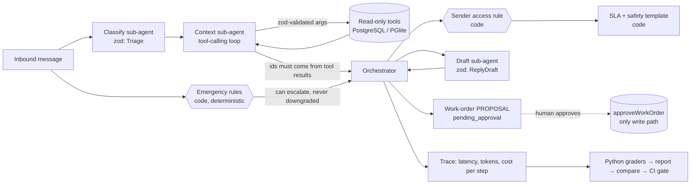

# property-agent-evals

**A property-management triage agent with an evaluation harness and a CI quality gate.**

Residents and landlords send messy messages: a dripping tap, a rent question, a noise complaint, a gas smell. The agent triages each one. An orchestrator hands the work to three sub-agents: one classifies the message and extracts fields, one calls tools to look up the property, unit, lease and open jobs in PostgreSQL, and one drafts the reply. Code, not the model, owns the emergency rules, the service levels, who may see which account, and the safety wording. The agent only **proposes** a work order; a named human approves it. A Python harness grades every run on field accuracy, hallucination, emergency recall, structured-output validity, latency and cost, and CI fails the build if a change makes any of them worse.

Stack: **TypeScript / Node.js** (agent service) · **PostgreSQL** (PGlite: real Postgres compiled to WASM, no server needed) · **Python** (eval harness, standard library only) · **zod** (structured outputs) · **Anthropic SDK** (optional live provider) · **GitHub Actions**.

Results page: [saeedfzn.github.io/property-agent-evals](https://saeedfzn.github.io/property-agent-evals/)

## What is real and what is simulated

**Real: this code executes on every run and in CI.**

- The orchestrator, the three sub-agents and the tool-calling loop, querying PostgreSQL through parameterised SQL.
- zod validation of every model output and every tool argument, with reject-and-retry once.
- Timeouts that cancel the in-flight request, retries with capped, jittered backoff, and a trace of every model call, tool call, rule and validation with latency, tokens and cost.
- The code-enforced rules: emergencies, sender access to account data, and the human-approval boundary.
- The Python graders, the report, the before/after comparison and the threshold gate.
- 62 vitest tests and 30 Python unittest tests.

**Simulated: the model.**

- Every number on this page comes from the **fixture provider** ([`src/model/fixture.ts`](src/model/fixture.ts)): a scripted, deterministic stand-in that implements the same `ModelProvider` interface as the live one. It uses no network, no key and no money.
- Its latency is a formula, its token counts are estimated from text length, and cost is those tokens at list price.
- **The v1 to v2 improvement is scripted too.** The fixture reads the system prompt it is given. If the prompt tells it to always promise a visit and has no grounding rule, it invents an appointment, which is a common failure of live models. So the results show that the graders catch invented facts in reply text and that the gate blocks the build. They do not show that the v2 prompt fixes a live model.

**Why build it this way.** An eval that calls a live model on every commit costs money, needs a secret, and gives slightly different numbers each run. With a scripted model the committed reports are byte-stable, so CI can fail on any regression against the committed baseline or any newly failing case, and malformed JSON and a timeout are injected on fixed calls so the retry paths run every time. Grading a live model uses the same harness with one environment variable changed (see [Live provider](#live-provider)).

The live Anthropic provider ([`src/model/anthropic.ts`](src/model/anthropic.ts), `claude-opus-5-5` by default) is built against the official SDK and unit-tested with a fake client. It is off unless `MODEL_PROVIDER=anthropic` **and** `ANTHROPIC_API_KEY` are both set, and a test enforces that.

All data in this repo is fictional. People, companies and addresses are invented, emails use `example.com`, and phone numbers use the Ofcom drama range. The only real numbers are the UK emergency numbers in the fixed safety wording.

## Quick start

Needs Node 24+ and Python 3.10+.

```bash
npm ci
npm run demo      # runs v1 and v2 over the 25 golden cases, grades, compares, gates
```

Other commands:

```bash
npm run typecheck && npm test && npm run build
npm run eval      # CI mode: run v2, gate it, compare with the committed baseline
python -m unittest discover -s evals/tests -v     # Windows: py -3 -m unittest ...
npm run triage -- --from t.okafor@example.com "The kitchen tap is still dripping, any update?"
```

`npm run triage -- --trace ...` prints the full trace. For the message above (fixture provider, so model latency is simulated):

```text
kind        span                          latency   in  out   cost
rule        rule:emergency                 0.7 ms                        no match
model       classify                       355 ms  173   42   $0.001532
validation  classify:validate
model       gather_context:step1           321 ms  705   29   $0.003400  tool_use
tool        tool:find_contact_by_email     1.6 ms
model       gather_context:step2           311 ms  813   26   $0.003772  tool_use
tool        tool:get_open_work_orders      2.0 ms
model       gather_context:step3           346 ms  947   27   $0.004328
validation  gather_context:validate
rule        rule:sender_access
model       draft_reply                    431 ms  312   50   $0.002248
validation  draft_reply:validate
```

(Five `load:*` database spans of 1 to 2 ms each are left out here for space.) The reply quotes the real booking from the database: *"This is already logged as job WO-1001, and the visit is booked for Thursday 19 November at 10:00 with Kestrelford Plumbing & Heating."*

## Results (from the committed reports)

The numbers below come from `evals/reports/v1.json` and `v2.json`. A test fails if this table falls out of sync with those files. They were produced with the **fixture provider**, so they demonstrate the harness and the gate; they are not a benchmark of a live model.

<!-- results:start -->
| Metric (25 golden cases, fixture provider) | v1 prompt | v2 prompt |
|---|---|---|
| Emergency recall (final, after code rules) | 100.0% | 100.0% |
| Emergency recall (model alone) | 80.0% | 80.0% |
| Emergency false-positive rate (lookalikes) | 0.0% | 0.0% |
| Field accuracy (6 fields x 25 cases) | 99.3% | 99.3% |
| Structured-output validity (first try / after retry) | 92% / 100% | 92% / 100% |
| **Hallucination rate** (replies with an ungrounded claim) | 64.0% | 0.0% |
| Ungrounded claims / checkable claims | 29 / 52 | 0 / 23 |
| Must-say / must-not-say pass rate | 96.0% | 100.0% |
| Cases passing every check | 32.0% | 96.0% |
| Latency p50 / p95 per message (simulated model time) | 1787 / 2249 ms | 1832 / 2271 ms |
| Est. cost per message (token count x list price) | $0.0169 | $0.0164 |
| Work orders written without approval | 0 | 0 |
<!-- results:end -->

**The before-and-after fix.** The v1 drafting prompt says *"Always tell the resident when they can expect a visit or a call back."* That sounds helpful, but nothing is booked for most messages, so the reply invents a visit date or time ("an engineer will visit on Thursday 19 November between 8am and 12pm"). It also repeats a flat number that does not exist. The v2 prompt adds grounding rules and sends the drafter only the facts it may use. The hallucination grader parses every date, time, flat number, job reference and £ amount out of the reply text and checks each one against the database. The eval shows the drop, and the gate blocks v1 (`hallucination_rate = 0.64 > 0.0`). Full diff: [`evals/reports/comparison.md`](evals/reports/comparison.md).

Three things to notice in the table:

- **Emergency recall is 100% because of code, not because of the model.** The scripted model misses the oblique "strong eggy smell near the meter cupboard" (model-only recall is 80%). The deterministic gas rule catches it, and the model can escalate urgency but never downgrade it. Lookalikes ("gas bill", "smoke alarm beeping, battery low") are in the golden set, so a 100% score can't come from flagging everything.
- **Invalid structured output is rejected and retried once.** The fixture provider returns malformed JSON on two calls and a timeout on one. First-attempt validity is 92%; after reject-and-retry it is 100%, and both retries appear in the trace.
- **v2 does not pass everything.** 24 of 25 cases pass every check. Case c14 ("is gas included in the rent?") is graded as a miss because the agent returns urgency `normal` where the golden label is `low`. It stays in the report as a failing case; the gate's thresholds, not a 100% pass rate, decide the build.

## What to look at



| Topic | What the code does | Where |
|---|---|---|
| Multi-step agent, sub-agent orchestration | An orchestrator runs classify, then context, then draft. Each sub-agent has its own prompt, output schema and failure handling. | `src/agents/orchestrator.ts` |
| Tool use | A bounded tool-calling loop (max 6 steps) over seven read-only tools. Arguments are zod-validated; a bad call goes back to the model as a tool error. Every id in the final answer must have come back from a tool, or it is dropped. | `src/agents/context.ts`, `src/tools.ts` |
| Structured outputs | Every sub-agent's answer is checked against a zod schema. For classify and draft, the same schema is converted to the JSON Schema sent to the model. Invalid output is rejected and retried once with the error fed back; two failures degrade to `needs_human`. | `src/agents/structured.ts`, `src/schemas.ts` |
| Reusable workflow | The orchestrator only talks to a `ModelProvider` interface, so the same orchestration, validation, retry and tracing code runs against the fixture and the live provider. Prompts are versioned. | `src/model/provider.ts`, `src/prompts.ts` |
| Evals and feedback loop | 25 golden cases, deterministic graders, per-case failure reasons, a before/after comparison, and thresholds that fail CI. A prompt change is reviewed like a code change. | `evals/harness/*.py`, `evals/golden/cases.jsonl`, `evals/thresholds.json` |
| Hallucination | Claims are parsed from the reply text and checked against the database. The drafter is sent only facts loaded by code. | `evals/harness/graders.py` |
| Reliability | Per-call timeout that aborts the request, retries on transient errors only (rate limit, 5xx, connection), capped exponential backoff with jitter. A model outage or refusal degrades one message to `needs_human` with a holding reply; a gas message still gets its emergency verdict, safety wording and on-call escalation, because none of those depend on a model call. | `src/reliability.ts`, `src/agents/structured.ts` |
| Latency and cost | Every span records latency, tokens and cost, priced by the model that served the call. p95 latency and cost per message have CI thresholds, and p50 is regression-checked against the committed baseline. v2 sends the drafter a trimmed payload. | `src/trace.ts`, `src/model/provider.ts` |
| Safety and access | Emergency rules, service levels and safety wording live in code. The lease, rent-ledger and job tools refuse any unit the sender is not the resident or landlord of, so another household's data reaches neither the model nor the reply, whatever flat the message names. The sender is identified by code from the From address. | `src/rules.ts`, `src/tools.ts`, `src/agents/orchestrator.ts` |
| Human approval | The agent returns a proposal. `approveWorkOrder()` is the only write path, needs a named approver, and takes its job reference from a Postgres sequence. A full golden-set run writes 0 rows. | `src/db.ts` |
| PostgreSQL | Schema and seed as SQL migrations with foreign keys, CHECK constraints and indexes; parameterised queries only. | `db/migrations/*.sql`, `src/db.ts` |
| CI | Typecheck, tests, build, grader tests, the eval with its gate and baseline comparison, and a step that proves the gate rejects v1. | `.github/workflows/ci.yml` |

### How the eval avoids grading itself

- The agent and the fixture provider only ever see each case's `input`. They never see `expected`.
- Validity is re-checked in Python. The agent's own zod check is not trusted.
- Hallucination is judged from the reply **text**, against a snapshot exported from the database. Each claim is scoped by the golden case, never by the agent's output:
  - to the true unit, so a real booking for the wrong flat is ungrounded;
  - to the one job the message is about, so another job booked on the same flat that day does not make an invented visit date true (case c16 under v1);
  - to the kind of question, so a rent due date or a tenancy end date cannot stand in for a visit date.
- Cases where a real visit *is* booked require the reply to quote it (`must_say`), so a prompt can't pass by saying nothing.
- Every grader has unit tests that feed it deliberately bad output and check that it fires.
- Known limits: the grader checks explicit dates, clock times, flat numbers, job references and £ amounts. It does not parse relative promises ("tomorrow morning", "later this week") or judge tone. Those need a model-graded check with human-labelled examples, which is the natural next grader to add.

### Live provider

`src/model/anthropic.ts` uses `@anthropic-ai/sdk`. Thinking is left at its adaptive default, and depth is set with `output_config.effort`. It sets `output_config.format` (JSON schema) for structured outputs, strict tools, the server-side refusal fallback, a typed error chain (rate-limit, 5xx and connection errors are retryable; 4xx are not), an abort signal tied to the per-call timeout, and verbatim replay of assistant content across tool turns. It sends no `temperature`, no forced `tool_choice` and no prefill. SDK retries are turned off so that every retry is made, and traced, by this code. To try it with your own key:

```bash
MODEL_PROVIDER=anthropic ANTHROPIC_API_KEY=sk-ant-... npm run eval:run -- --prompt v2 --out evals/runs/live
python evals/harness/report.py --run evals/runs/live --out evals/runs/live/report
```

The fixture provider stays the default even when a key is set in the environment.

### Taking it further

- Route by task: a smaller model for classification, with the eval deciding whether quality holds, and prompt caching for the fixed system prompts and tool list.
- Grow the golden set from real traffic with human labels, and add a model-graded check for tone and relative promises alongside the deterministic graders.
- Persist proposals and traces to PostgreSQL and export spans with OpenTelemetry, so approval rates and human edits to drafts feed back into the golden set.

## About me

Faizaan Saeed, AI & Power Platform developer, Swindon.

- Delivered a stock-control system for a satellite and RF manufacturer on a 15-day contract: a Power Apps app, six Power Automate flows, reports and a dashboard. It went through 56 versioned releases and was signed off and handed over with user, admin and technical guides.
- Builds every day with Claude Code, using MCP connectors, skills and sub-agents.
- Built MechAI, an AI vehicle-diagnostics platform on Python/FastAPI and PostgreSQL over ~143 million rows that calls an LLM API.
- Portfolio: [saeedfzn.github.io](https://saeedfzn.github.io) · Other repo: [github.com/saeedfzn/ai-delivery-toolkit](https://github.com/saeedfzn/ai-delivery-toolkit)

## Licence

MIT
